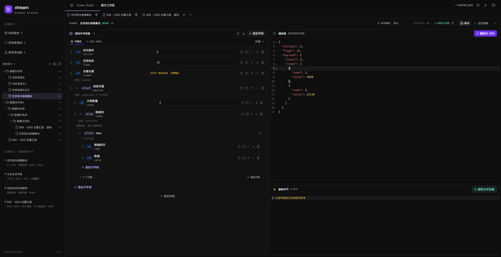
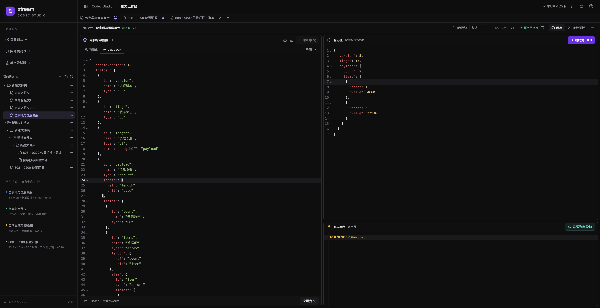
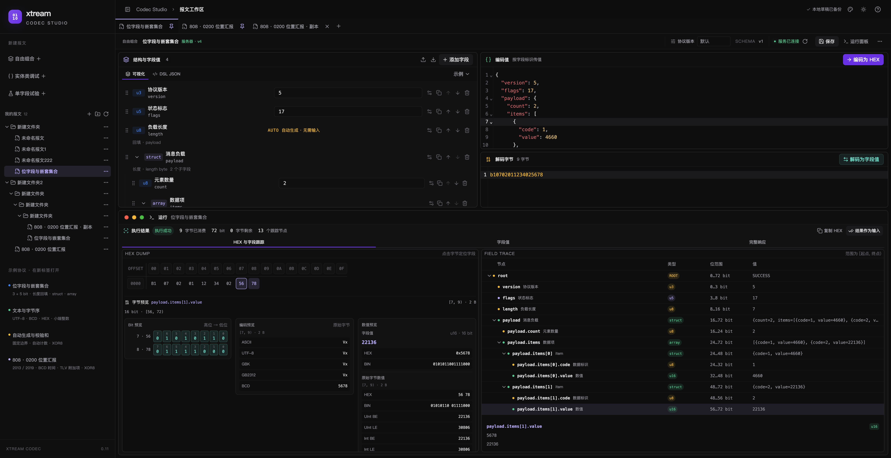
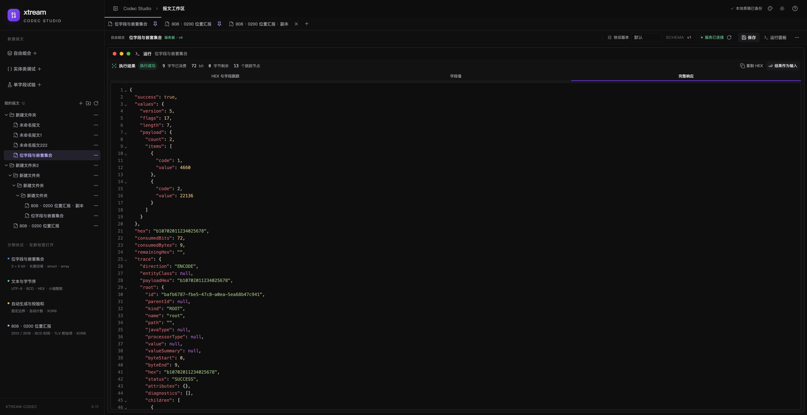
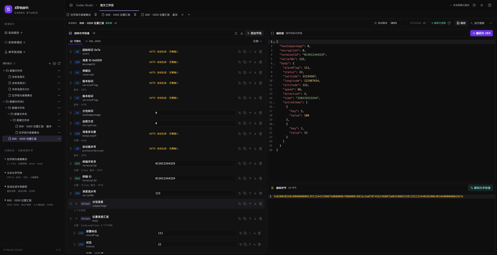
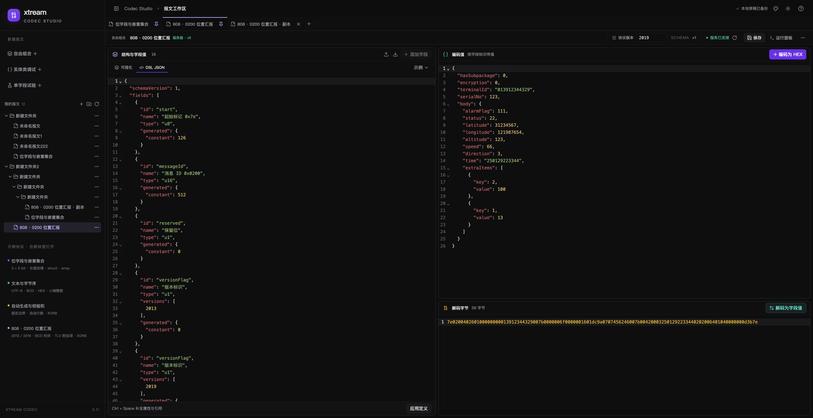
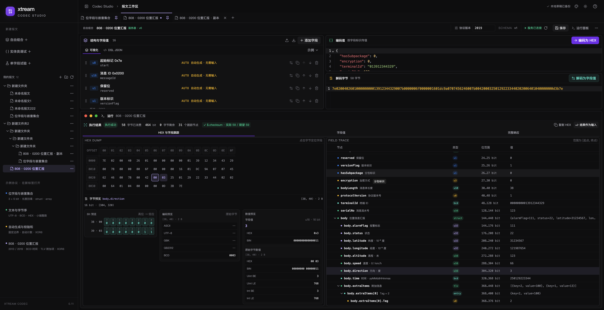
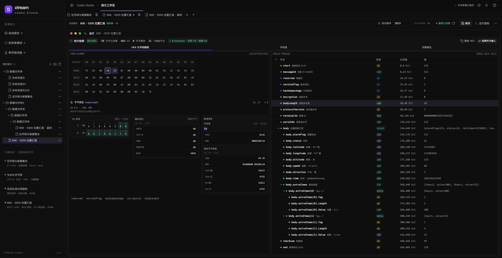
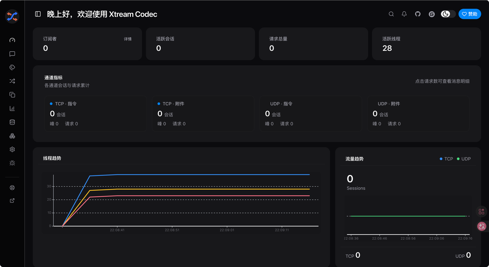

# xtream-codec

<p align="center">
    <a href="https://github.com/hylexus/xtream-codec">
        
    </a>
</p>

<p align="center">
    <a href="https://deepwiki.com/hylexus/xtream-codec">
        
    </a>
    <br/>
    <a href="https://www.apache.org/licenses/LICENSE-2.0">
        
    </a>
    <a href="https://openjdk.org/projects/jdk/21">
        
    </a>
    <a href="https://central.sonatype.com/namespace/io.github.hylexus.xtream">
        
    </a>
    <br/>
    <a href="https://github.com/hylexus/xtream-codec/actions/workflows/gradle-build-linux-platform.yml">
        
    </a>
    <a href="https://github.com/hylexus/xtream-codec/graphs/commit-activity">
        
    </a>
    <br/>
    <a href="https://github.com/hylexus/xtream-codec/graphs/commit-activity">
        
    </a>
    <a href="https://github.com/hylexus/xtream-codec/graphs/commit-activity">
        
    </a>
    <a href="https://github.com/hylexus/xtream-codec/graphs/commit-activity">
        
    </a>
    <a href="https://github.com/hylexus/xtream-codec/graphs/commit-activity">
        
    </a>
</p>

> [!IMPORTANT]
> 遵守适用许可证即可使用、修改、再分发及商用。
>
> You may use, modify, redistribute and use xtream-codec commercially under the applicable licenses.
>
> [免责声明与第三方商业化 / Disclaimer and third-party commercialization](docs/src/disclaimer.md)

## Tips / 提示

> 2026.1 版的 idea 中打开项目可能会报错

- 临时解决方案: 临时禁用掉 idea 内置的 `Spark` 插件
- 详情参考: [https://youtrack.jetbrains.com/issue/IDEA-386409](https://youtrack.jetbrains.com/issue/IDEA-386409)

> 部分代码和资源在 AI 辅助下完成，相关记录见源码或[静态资源说明](assets/STATIC-ASSETS.md)。

## ProjectNaming / 项目命名

项目名来源: `xtream-codec == xtream + codec`

- `xtream == Extensible + Stream`(发音特点合成)
    - `Extensible`: 可扩展
    - `Stream`: <span style="color:red;font-weight:bold;">非阻塞</span>
      的流式编程 ([projectreactor](https://projectreactor.io))
- `codec == Coder + Decoder`

## Intro / 介绍

该项目是一个基于 [projectreactor](https://projectreactor.io/) 的、和具体协议无关的、异步的、<span style="color:red;">非阻塞的</span>、TCP/UDP 服务端实现。

### Design Philosophy / 设计理念

该项目最初的设计目标，是把开发者熟悉的 **Spring MVC 请求处理模式复刻到 TCP/UDP 技术栈**：让二进制私有协议也能像 Web 应用一样，将请求路由、处理器调用、参数解析、返回值处理、过滤器和统一异常处理拆分成职责清晰、可以独立扩展的组件。

随着实现逐步深入，项目最终主要采用了更适合 Netty 异步 I/O 的 **Spring WebFlux** 设计。当前服务端请求处理主链路、核心接口的职责划分和响应式编排方式都直接来源于 Spring WebFlux；部分基础类型也是在 Spring 对应实现的基础上移植并针对 TCP/UDP 场景改造的。

这套设计复刻的是 Spring 的 **编程模型、组件边界和扩展机制**，不是把 TCP/UDP 包装成 HTTP。TCP/UDP 连接与数据收发仍由 Reactor Netty 和 Xtream 自己的服务器组件负责，Spring 容器主要用于发现、装配和配置各类扩展组件。

| Spring / Spring WebFlux        | Xtream                               | 职责                               |
|--------------------------------|--------------------------------------|------------------------------------|
| `ServerWebExchange`            | `XtreamExchange`                     | 聚合请求、响应、会话和请求级上下文 |
| `WebFilter` / `WebFilterChain` | `XtreamFilter` / `XtreamFilterChain` | 组成请求过滤器链                   |
| `DispatcherHandler`            | `DispatcherXtreamHandler`            | 编排请求分发流程                   |
| `HandlerMapping`               | `XtreamHandlerMapping`               | 根据协议请求找到处理器对象         |
| `HandlerAdapter`               | `XtreamHandlerAdapter`               | 识别并执行不同类型的处理器         |
| `HandlerResultHandler`         | `XtreamHandlerResultHandler`         | 处理业务返回值并写出协议响应       |
| `WebExceptionHandler`          | `XtreamRequestExceptionHandler`      | 统一处理请求链路中的异常           |

核心处理流程与 WebFlux 一致：

```text
请求解码 → FilterChain → HandlerMapping → HandlerAdapter → HandlerResultHandler → 响应编码与写出
```

`XtreamHandlerMapping` 返回的是 `Object`，而不是某个固定的处理器接口；具体如何执行该对象由匹配的 `XtreamHandlerAdapter` 决定。因此，基于注解的处理器、`SimpleXtreamRequestHandler` 和任意自定义处理器对象可以共存于同一套分发管线中。

详细设计与扩展原理：

- [DispatcherXtreamHandler 请求分发机制](docs/src/guide/server/request-processing/dispatcher-handler.md)
- [JT/T 808 自定义请求处理器](docs/src/ext/jt/jt808/customization/request-handler.md)

同时提供了基于 [xtream-codec-server-reactive](xtream-codec-server-reactive) 的 [JT/T 808 协议](ext/jt/jt-808-server-spring-boot-starter-reactive) 和 `JT/T 1078 协议` 的服务端实现：

- JT/T 808 协议
    - 支持多版本 (**V2013,V2019**)
    - 支持分包
    - 支持加解密
    - 支持指令下发
    - 支持苏标附件服务
    - 支持链路数据订阅
    - 提供了一个基于 **Spring Boot** 的 **Dashboard**
- JT/T 1078 协议 (开发中)
    - quick-start
        - [基于 Webflux](quick-start/jt/jt-1078-server-quick-start-nonblocking/docker/jt-1078-server-quick-start-nonblocking)
        - [基于 Servlet](quick-start/jt/jt-1078-server-quick-start-blocking/docker/jt-1078-server-quick-start-blocking)
    - 参考资料 (以下排名不分先后):
        - [https://rtmp.veriskope.com/pdf/video_file_format_spec_v10.pdf](https://rtmp.veriskope.com/pdf/video_file_format_spec_v10.pdf)
        - [Gitee - matrixy/jtt1078-video-server](https://gitee.com/matrixy/jtt1078-video-server)
        - [Gitee - sky/jt1078](https://gitee.com/hui_hui_zhou/open-source-repository)
        - [Gitee - ldming/JT1078](https://gitee.com/ldming/JT1078)
        - [https://www.bilibili.com/video/BV1nG4y1u7HT](https://www.bilibili.com/video/BV1nG4y1u7HT)
        - [https://www.jianshu.com/p/916899d4833b](https://www.jianshu.com/p/916899d4833b)
        - [https://www.jianshu.com/p/07657d85617e](https://www.jianshu.com/p/07657d85617e)
        - [https://www.cnblogs.com/chyingp/p/flv-getting-started.html](https://www.cnblogs.com/chyingp/p/flv-getting-started.html)
        - [https://www.cnblogs.com/CoderTian/p/8278369.html](https://www.cnblogs.com/CoderTian/p/8278369.html)
        - [https://sample-videos.com/index.php#sample-flv-video](https://sample-videos.com/index.php#sample-flv-video)
        - ...

## Modules / 项目模块

```shell
.
├── build-script  ## 构建脚本
├── docs          ## 文档
├── ext           ## 扩展模块
│     └── jt      ## JT/T 扩展
│         ├── jt-808-server-dashboard-spring-boot-starter-reactive  ## JT/T 808 扩展 - Dashboard - Server
│         ├── jt-808-server-dashboard-ui                            ## JT/T 808 扩展 - Dashboard - UI
│         └── jt-808-server-spring-boot-starter-reactive  ## JT/T 808 扩展
├── quick-start   ## quick-start 示例
│     └── jt      ## JT/T 示例
│         ├── jt-808-attachment-server-quick-start-blocking           ## JT/T 808 附件服务器服务端示例(不带 dashboard)
│         ├── jt-808-attachment-server-quick-start-nonblocking        ## JT/T 808 附件服务器服务端示例(不带 dashboard)
│         ├── jt-808-server-quick-start                               ## JT/T 808 服务端示例(不带 dashboard)
│         ├── jt-808-server-quick-start-with-dashboard                ## JT/T 808 服务端示例(带 dashboard)
│         ├── jt-808-server-quick-start-with-storage-blocking         ## JT/T 808 服务端[阻塞版-SpringMvc]示例(带 存储:clickhouse,mysql,postgres,minio)
│         └── jt-808-server-quick-start-with-storage-nonblocking      ## JT/T 808 服务端[非阻塞版-WebFlux]示例(带 存储:clickhouse,mysql,postgres,minio)
├── debug         ## 调试专用(不用理会)
│     ├── jt      ## JT/T 示例(不用理会)
│     │   └── jt-808-server-spring-boot-starter-reactive-debug   ## JT/T 808 服务端调试(不用理会)
│     ├── xtream-codec-core-debug                       ## xtream-codec-core 模块调试(不用理会)
│     ├── xtream-codec-server-reactive-debug-tcp        ## xtream-codec-server-reactive TCP 调试(不用理会)
│     └── xtream-codec-server-reactive-debug-udp        ## xtream-codec-server-reactive UDP 调试(不用理会)
├── xtream-codec-core                                   ## xtream-codec-core 核心编解码模块
├── xtream-codec-studio-app                             ## 独立报文编辑器、编解码调试与持久工作区
├── xtream-codec-studio-ui                              ## Studio 前端（React + HeroUI 3 + Vite）
└── xtream-codec-server-reactive                        ## 异步非阻塞的 TCP/UDP 服务端实现
```

## Codec Studio / 报文工作区

独立的报文编辑器与编解码工作区，支持可视化配置字段、编辑动态 DSL、编码和解码、HEX 与字段跟踪联动，以及多文档保存。运行单文件 JAR 只需 Java 21，也支持 Docker 部署。

> **Studio 与具体协议无关，Dashboard 是 JT/T 808 协议专用。** Studio 是通用报文编辑与编解码调试工具，可用于自定义二进制协议，无需启动 JT/T 808 服务端或连接真实终端；Dashboard 集成在 JT/T 808 服务端中，用于查看 808 服务状态、在线会话和进行 808 协议联调。
>
> 下方 Studio 的 JT/T 808 0200 截图用于演示通用 DSL 的配置，Studio 也可编辑和调试其他协议的报文。接入 808 终端并使用 Dashboard 的启动方式见下方 [JT/T 808 QuickStart](#jtt-808-quickstart)。

使用方式见 [Studio 启动与部署](docs/src/guide/core/dynamic/studio.md)，报文配置见 [从协议表写出第一份 DSL](docs/src/guide/core/dynamic/quick-start.md)。

```shell
# 支持 amd64 和 arm64 两种架构
docker run -it --rm \
  -p 127.0.0.1:8765:8765 \
  -v xtream-codec-studio-data:/data \
  registry.cn-hangzhou.aliyuncs.com/xtream-codec/xtream-codec-studio-app:latest
```

启动后访问：[http://127.0.0.1:8765](http://127.0.0.1:8765)。服务器中已保存的报文存放在命名卷 `xtream-codec-studio-data`，退出并删除容器后仍会保留。

下面展示两个内置样例，点击图片可查看原图。

### 位字段与嵌套集合

| 可视化结构与编码值                                                                                                                                                                                         | DSL JSON                                                                                                                                                                                            |
|------------------------------------------------------------------------------------------------------------------------------------------------------------------------------------------------------------|-----------------------------------------------------------------------------------------------------------------------------------------------------------------------------------------------------|
| [](docs/src/.vuepress/public/img/readme/xtream-codec-studio-demo-01-01.png) | [](docs/src/.vuepress/public/img/readme/xtream-codec-studio-demo-01-02.png) |

| HEX 与字段跟踪                                                                                                                                                                                         | 完整响应                                                                                                                                                                                         |
|--------------------------------------------------------------------------------------------------------------------------------------------------------------------------------------------------------|--------------------------------------------------------------------------------------------------------------------------------------------------------------------------------------------------|
| [](docs/src/.vuepress/public/img/readme/xtream-codec-studio-demo-01-03.png) | [](docs/src/.vuepress/public/img/readme/xtream-codec-studio-demo-01-04.png) |

### JT/T 808 0200 位置汇报

| 多版本结构与业务值                                                                                                                                                                                               | 协议 DSL JSON                                                                                                                                                                                                    |
|------------------------------------------------------------------------------------------------------------------------------------------------------------------------------------------------------------------|------------------------------------------------------------------------------------------------------------------------------------------------------------------------------------------------------------------|
| [](docs/src/.vuepress/public/img/readme/xtream-codec-studio-808-0200-01.png) | [](docs/src/.vuepress/public/img/readme/xtream-codec-studio-808-0200-02.png) |

| 运行结果与校验                                                                                                                                                                                                   | 位段与 TLV 明细                                                                                                                                                                                                     |
|------------------------------------------------------------------------------------------------------------------------------------------------------------------------------------------------------------------|---------------------------------------------------------------------------------------------------------------------------------------------------------------------------------------------------------------------|
| [](docs/src/.vuepress/public/img/readme/xtream-codec-studio-808-0200-03.png) | [](docs/src/.vuepress/public/img/readme/xtream-codec-studio-808-0200-04.png) |

## JT/T 808 QuickStart

以下镜像会同时启动 **JT/T 808 服务端和 Dashboard 管理界面**，用于终端接入与服务端联调。

```shell
# 支持 amd64 和 arm64 两种架构
docker run -it --rm -p 8888:8888 registry.cn-hangzhou.aliyuncs.com/xtream-codec/jt-808-server-quick-start-with-dashboard:latest
```

启动后访问: [http://localhost:8888/dashboard-ui/](http://localhost:8888/dashboard-ui/)

| 首页                                                                                               | 编解码调试                                                                                     |
|----------------------------------------------------------------------------------------------------|------------------------------------------------------------------------------------------------|
|  |  |

## Roadmap / 版本路线图

通过 [GitHub Milestones](https://github.com/hylexus/xtream-codec/milestones) 管理未来的版本计划

> 欢迎在 Issue 中讨论设计，或认领 `help wanted` 任务参与开发

## Compatibility / 兼容性

参考 : [https://start.spring.io/actuator/info](https://start.spring.io/actuator/info)

> 非 spring 项目可以不用理会这个兼容性
>
> 但依然建议使用 [spring-boot-dependencies](https://central.sonatype.com/artifact/org.springframework.boot/spring-boot-dependencies) 这个 `BOM` 来管理 N 多依赖的兼容性问题

| xtream-version | spring-boot-dependencies | spring-cloud-dependencies |
|----------------|--------------------------|---------------------------|
| **0.1.x**      | **3.5.6 +**              | **2025.0.0**              |
| **0.0.x**      | **3.2.x +**              | **2023.0.3**              |

## Docs / 文档

- 国内站点: https://iotplanet.top/xtream-codec/
- Github: https://hylexus.github.io/xtream-codec/
- DeepWiki (**AI** 生成): https://deepwiki.com/hylexus/xtream-codec/

## QuickStart / 快速入门

- **Maven** 版示例: [https://github.com/iotplanet/jt-808-quick-start](https://github.com/iotplanet/jt-808-quick-start)
- 带存储的 **JT/T 808** 服务示例
    - 非阻塞版 [jt-808-server-quick-start-with-storage-nonblocking](quick-start/jt/jt-808-server-quick-start-with-storage-nonblocking/README.md)
    - 阻塞版 [jt-808-server-quick-start-with-storage-blocking](quick-start/jt/jt-808-server-quick-start-with-storage-blocking/README.md)
- **自定义** 协议示例
    - 国内站点: https://iotplanet.top/xtream-codec/guide/core/samples/custom-protocol-sample-01/protocol.html
    - Github: https://hylexus.github.io/xtream-codec/guide/core/samples/custom-protocol-sample-01/protocol.html
- **JT/T 808** 协议示例
    - 国内站点:https://iotplanet.top/xtream-codec/guide/core/samples/custom-protocol-sample-02/protocol.html
    - Github: https://hylexus.github.io/xtream-codec/guide/core/samples/custom-protocol-sample-02/protocol.html

## License / 开源协议

`xtream-codec` 的项目代码使用 [Apache License, Version 2.0](https://www.apache.org/licenses/LICENSE-2.0)，文件或目录另有声明的除外。 详情见 [LICENSE](LICENSE) 和 [NOTICE](NOTICE)。

- 第三方源码、依赖和模板保留各自的许可证；两个 Dashboard UI 目录保留 Next UI 模板的 MIT 许可
- JT1078 的 Symphonia 派生 ADPCM 文件适用 MPL-2.0，归档附带对应源码
- jump3r 的上游 Maven POM 声明 LGPL-2.1-or-later。实际捆绑该库的 Boot 和 Shadow 应用附带同版本源码、许可材料和重建工具。该工具也可替换未签名且无前置启动脚本的 Spring Boot JAR 中的嵌套库。详见 [第三方许可材料](THIRD-PARTY-MATERIALS.md)。
- 前端生产构建生成 `THIRD-PARTY-FRONTEND-NOTICES.txt`，静态部署、JAR 和镜像分发时须保留

第三方依赖的许可证信息:

- 项目归属声明见 JAR 中的 `META-INF/NOTICE.txt`。Boot 和 Shadow 应用的 JVM 补充许可见 `META-INF/open_source_licenses.txt`。
- 运行 `./gradlew generateLicenseReport` 可在各模块的 `build/reports/dependency-license/` 下生成 `THIRD-PARTY-NOTICES.txt`。
- 来源核实情况与发布待办见 [许可证审查记录](build-script/license/README.md)。JVM 报告不覆盖复制源码和 npm 依赖，当前仍有待核实事项。

## Funding / 打赏

项目的发展离不开你的支持，请作者喝一杯🍺吧！


## References / 参考资料 / 致谢

- [https://github.com/anomalyco/opencode](https://github.com/anomalyco/opencode)
- [https://github.com/forrestchang/andrej-karpathy-skills](https://github.com/forrestchang/andrej-karpathy-skills)
- [https://github.com/Fission-AI/OpenSpec](https://github.com/Fission-AI/OpenSpec)
- [https://github.com/code-yeongyu/oh-my-openagent](https://github.com/code-yeongyu/oh-my-openagent)

## TODO / 待办

- [JT/T 1078 扩展](ext/jt/jt-1078-server-spring-boot-starter-reactive)
    - [ ] 代码简化 (80%)
    - [ ] 码流断开时未消费的数据未释放的问题
    - 协议
        - [x] TCP
        - [x] UDP
            - 没有实现一个 UDP 包中包含多个 RTP 包的场景
            - 没有实现 UDP 包乱序的处理
    - [ ] 音频
        - [x] ADPCMA（以下参考资料排名不分先后）
            - [https://wiki.multimedia.cx/index.php/IMA_ADPCM](https://wiki.multimedia.cx/index.php/IMA_ADPCM)
            - [https://www.hentai.org.cn/article?id=8](https://www.hentai.org.cn/article?id=8)
            - [https://github.com/pdeljanov/Symphonia.git](https://github.com/pdeljanov/Symphonia.git)
            - [https://www.cs.columbia.edu/~hgs/audio/dvi/IMA_ADPCM.pdf](https://www.cs.columbia.edu/~hgs/audio/dvi/IMA_ADPCM.pdf)
            - [https://ww1.microchip.com/downloads/en/AppNotes/00643b.pdf](https://ww1.microchip.com/downloads/en/AppNotes/00643b.pdf)
        - [x] G711
            - 翻译自 [mazcpnt/maz-g711](https://gitee.com/mazcpnt/maz-g711/blob/master/maz_cpnt_g711.c)
        - [ ] G726
        - [x] AAC
            - 感谢 [@sky](https://gitee.com/hui_hui_zhou/open-source-repository)
    - [ ] 视频
        - [x] H.264（以下参考资料排名不分先后）
            - [https://rtmp.veriskope.com/pdf/video_file_format_spec_v10.pdf](https://rtmp.veriskope.com/pdf/video_file_format_spec_v10.pdf)
            - [https://gitee.com/ldming/JT1078](https://gitee.com/ldming/JT1078)
            - [https://gitee.com/matrixy/jtt1078-video-server](https://gitee.com/matrixy/jtt1078-video-server)
            - [https://gitee.com/hui_hui_zhou/open-source-repository](https://gitee.com/hui_hui_zhou/open-source-repository)
            - [https://www.cnblogs.com/CoderTian/p/8278369.html](https://www.cnblogs.com/CoderTian/p/8278369.html)
            - [https://sample-videos.com/index.php#sample-flv-video](https://sample-videos.com/index.php#sample-flv-video)
            - [https://www.jianshu.com/p/916899d4833b](https://www.jianshu.com/p/916899d4833b)
            - [https://www.jianshu.com/p/07657d85617e](https://www.jianshu.com/p/07657d85617e)
            - [https://www.cnblogs.com/chyingp/p/flv-getting-started.html](https://www.cnblogs.com/chyingp/p/flv-getting-started.html)
        - [ ] H.265
    - SIM
        - [x] `BCD[6]`
        - [x] `BCD[10]`
            - 感谢 [@sky](https://gitee.com/hui_hui_zhou/open-source-repository)
    - [ ] [jt-1078-server-dashboard-ui](ext/jt/jt-1078-server-dashboard-ui) 开发
- [JT/T 808 扩展](ext/jt/jt-808-server-spring-boot-starter-reactive)
    - [ ] 术语重命名为 `Jt808` 标准中出现的单词
    - [ ] [jt-808-server-dashboard-ui](ext/jt/jt-808-server-dashboard-ui) 完善
- [xtream-codec-core](xtream-codec-core)
    - [ ] 注解增强
- [xtream-codec-server-reactive](xtream-codec-server-reactive)
    - [ ] 简化初始化代码
