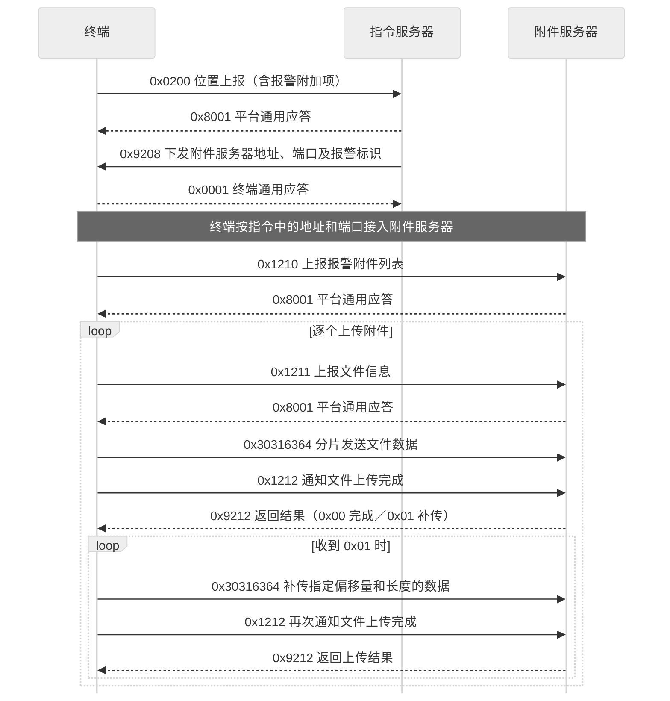

# 苏标

## 介绍

`jt-808-server-spring-boot-starter-reactive` 中已经内置了对苏标的支持。

## 附件上传时序

终端完成 JT/T 808 鉴权后，从带报警附加项的位置上报开始触发附件上传。


`0x9212` 的结果为 `0x00` 时，终端可以继续上传下一份附件。结果为 `0x01` 时，终端按应答中的偏移量和长度补传文件片段。下方示例的 `0x9212` 固定返回 `0x00`。

::: details Mermaid 源码



:::

## 启用附件服务

```yaml
jt808-server:
  ## ... 省略其他配置 ...
  ## 附件服务器
  attachment-server:
    # TCP 服务配置(附件服务器)
    tcp-server:
      enabled: true
      host: 0.0.0.0
      port: 3824
      ## 指令报文的最大长度
      ## @see: io.netty.handler.codec.DelimiterBasedFrameDecoder.maxFrameLength
      max-instruction-frame-length: 1024
      ## 苏标扩展码流消息 0x30316364 的最大长度(66560 = 1024 * 65)
      ## @see io.netty.handler.codec.DelimiterBasedFrameDecoder.maxFrameLength
      max-stream-frame-length: 66560
      ## 附件务器的会话空闲状态检查器(TCP)
      session-idle-state-checker:
        reader-idle-time: 0s
        writer-idle-time: 0s
        all-idle-time: 10m
      ## 请求处理线程
      loop-resources:
        select-count: 1
        worker-count: 10
        thread-name-prefix: xtream-tcp
        daemon: true
        colocate: true
        prefer-native: true
    # UDP 服务配置(附件服务器)
    udp-server:
      enabled: true
      # 绑定所有网卡
      host: 0.0.0.0
      # UDP 服务端口
      port: 3618
      ## 附件服务器的会话空闲状态检查器(UDP)
      session-idle-state-checker:
        max-idle-time: 10m
        check-interval: 10s
        check-backoff-time: 10s
      ## 请求处理线程
      loop-resources:
        select-count: 1
        worker-count: 10
        thread-name-prefix: xtream-udp
        daemon: true
        colocate: true
        prefer-native: true
```

## 附件消息处理示例

码流消息`0x30316364`(注意 <span style="color:red;">不是</span> **JT/T 1078** 协议中的码流，而是苏标扩展的附件文件码流) 已经被模拟成了一个普通的 **JT/T 808** 消息。可以直接使用注解处理器处理。

示例代码如下：

```java
@Component
@Jt808RequestHandler
public class AttachmentFileHandler {
    private static final Logger log = LoggerFactory.getLogger(AttachmentFileHandler.class);
    // <terminalId, <fileName, AttachmentItem>>
    // 只是个示例而已 看你需求自己改造
    private final Cache<String, Map<String, BuiltinMessage1210.AttachmentItem>> attachmentItemCache = Caffeine.newBuilder()
            .expireAfterWrite(Duration.ofMinutes(5))
            .build();

    private final AttachmentFileService attachmentFileService;

    public AttachmentFileHandler(AttachmentFileService attachmentFileService) {
        this.attachmentFileService = attachmentFileService;
    }

    @Jt808RequestHandlerMapping(messageIds = 0x1210)
    @Jt808ResponseBody(messageId = 0x8001)
    public Mono<ServerCommonReplyMessage> processMsg0x1210(Jt808Request request, Jt808Session session, @Jt808RequestBody BuiltinMessage1210 body) {
        log.info("0x1210 ==> {}", body);
        if (request.serverType() == Jt808ServerType.INSTRUCTION_SERVER) {
            log.error("{}", "0x1210 不应该由指令服务器对应的端口处理");
        }
        final Map<String, BuiltinMessage1210.AttachmentItem> itemMap = this.attachmentItemCache.get(session.terminalId(), key -> new HashMap<>());
        for (final BuiltinMessage1210.AttachmentItem item : body.getAttachmentItemList()) {
            item.setGroup(body);
            itemMap.put(item.getFileName().trim(), item);
        }
        return Mono.just(ServerCommonReplyMessage.success(request.header().flowId(), request.header().messageId()));
    }

    @Jt808RequestHandlerMapping(messageIds = 0x1211)
    @Jt808ResponseBody(messageId = 0x8001)
    public Mono<ServerCommonReplyMessage> processMsg0x1211(Jt808Request request, @Jt808RequestBody BuiltinMessage1211 body) {
        log.info("0x1211 ==> {}", body);
        if (request.serverType() == Jt808ServerType.INSTRUCTION_SERVER) {
            log.error("{}", "0x1211 不应该由指令服务器对应的端口处理");
        }
        return Mono.just(ServerCommonReplyMessage.success(request.header().flowId(), request.header().messageId()));
    }

    @Jt808RequestHandlerMapping(messageIds = 0x1212)
    @Jt808ResponseBody(messageId = 0x9212)
    public Mono<BuiltinMessage9212> processMsg0x1212(Jt808Request request, @Jt808RequestBody BuiltinMessage1212 body) {
        log.info("0x1212 ==> {}", body);
        if (request.serverType() == Jt808ServerType.INSTRUCTION_SERVER) {
            log.error("{}", "0x1212 不应该由指令服务器对应的端口处理");
        }
        final BuiltinMessage9212 responseMessageBody = new BuiltinMessage9212();
        responseMessageBody.setFileNameLength(body.getFileNameLength());
        responseMessageBody.setFileName(body.getFileName());
        responseMessageBody.setFileType(body.getFileType());
        // 0x00：完成
        // 0x01：需要补传
        responseMessageBody.setUploadResult((short) 0x00);
        responseMessageBody.setPackageCountToReTransmit((short) 0);
        responseMessageBody.setRetransmitItemList(Collections.emptyList());

        return Mono.just(responseMessageBody);
    }

    /**
     * 这里对应的是苏标附件上传的码流 0x30316364
     */
    @Jt808RequestHandlerMapping(messageIds = 0x30316364, desc = "苏标扩展码流")
    public Mono<Void> processMsg30316364(Jt808Request request, @Jt808RequestBody BuiltinMessage30316364 body, @Nullable Jt808Session session) {
        if (session == null) {
            log.warn("session == null, 附件上传之前没有没有发送 0x1210,0x1211 消息???");
            return Mono.empty();
        }

        log.info("0x30316364 ==> {} -- {} -- {}", body.getFileName().trim(), body.getDataOffset(), body.getDataLength());

        final Map<String, BuiltinMessage1210.AttachmentItem> itemMap = attachmentItemCache.getIfPresent(session.terminalId());
        if (itemMap == null) {
            return Mono.empty();
        }

        final BuiltinMessage1210.AttachmentItem item = itemMap.get(body.getFileName().trim());
        if (item == null) {
            log.error("收到未知附件上传消息: {}", body);
            return Mono.empty();
        }

        // 这里的示例都是随便瞎写的 存储到本地磁盘了
        // 实际场景中看你自己需求  比如存储到 OSS、AWS、Minio……
        return this.attachmentFileService.writeDataFragmentAsync(session, body, item.getGroup())
                .flatMap(dataSize -> {
                    // ...
                    return Mono.empty();
                });
    }
}
```

源代码参考下面链接：

- [Github - AttachmentFileHandler](https://github.com/hylexus/xtream-codec/blob/main/debug/jt/jt-808-server-spring-boot-starter-reactive-debug/src/main/java/io/github/hylexus/xtream/debug/ext/jt808/handler/AttachmentFileHandler.java)
- [Gitee - AttachmentFileHandler](https://gitee.com/hylexus/xtream-codec/blob/main/debug/jt/jt-808-server-spring-boot-starter-reactive-debug/src/main/java/io/github/hylexus/xtream/debug/ext/jt808/handler/AttachmentFileHandler.java)
