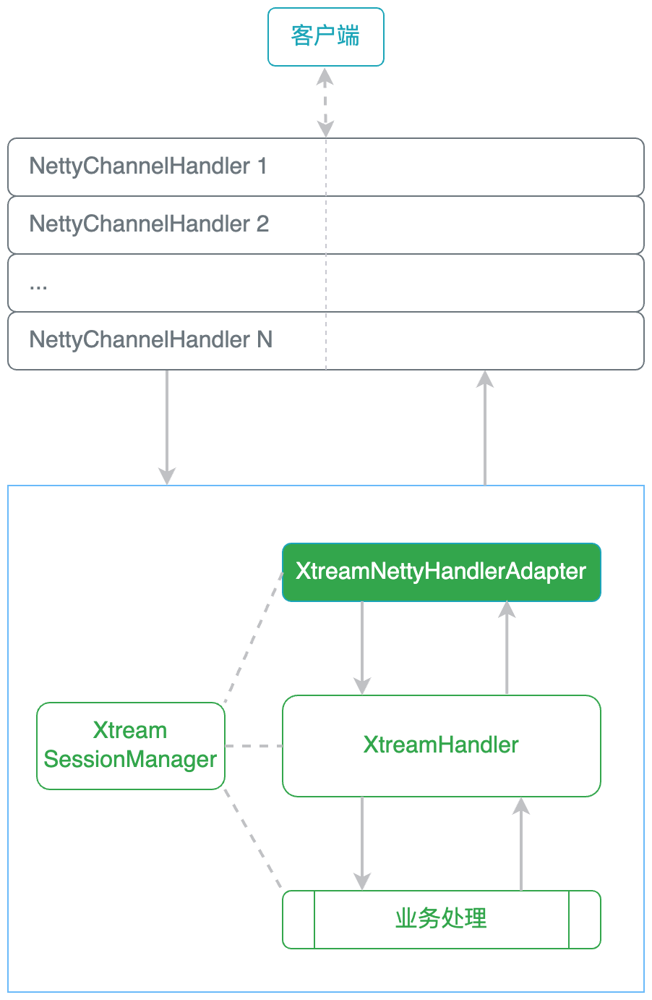

# NettyHandlerAdapter

## 请求处理流程

下图是一个简化版的请求处理流程：

通过上图不难看出，`NettyHandlerAdapter` 是 **xtream** 中客户端请求的入口。
也就是说，从这里开始，**Xtream** 接管了 `reactor-netty` 收到的客户端数据。

## 和 reactor-netty 的整合

xtream-codec 在配置 TCP 服务时，将 `TcpXtreamNettyHandlerAdapter` 注册到 Reactor Netty 的 `TcpServer.handle(...)`。
客户端建立连接后，Reactor Netty 将该连接的 `NettyInbound` 和 `NettyOutbound` 交给适配器。
默认适配器从 `NettyInbound` 接收数据，并把入站数据和基于 `NettyOutbound` 的响应封装为 `XtreamExchange`，再交给项目的请求处理链。

Reactor Netty 的接收数据示例见官方文档 [Consuming Data](https://projectreactor.io/docs/netty/release/reference/tcp-server.html#consuming-data)。
如需查看方法实现，可参阅 [Reactor Netty 1.2.17 的 `TcpServer.handle` 源码](https://github.com/reactor/reactor-netty/blob/3f6ae4cfdac208102d3b8046452fdd970afa220c/reactor-netty-core/src/main/java/reactor/netty/tcp/TcpServer.java#L115-L118)。

## 内置实现

- `DefaultTcpXtreamNettyHandlerAdapter`: 处理 **TCP** 请求的内置实现
- `DefaultUdpXtreamNettyHandlerAdapter`: 处理 **UDP** 请求的内置实现

这两个内置实现大同小异，基本流程如下:

- 将请求信息封装为统一的 `XtreamExchange`
    - `XtreamRequest`
    - `XtreamResponse`
    - `XtreamSession`
- 将 `XtreamExchange` 的处理委托给`XtreamHandler.handle(XtreamExchange)`
- 从这里开始，统一了 **TCP** 和 **UDP** 的编程接口

有关 `XtreamHandler` 的更多信息，见 [XtreamHandler](./xtream-handler.md) 。
